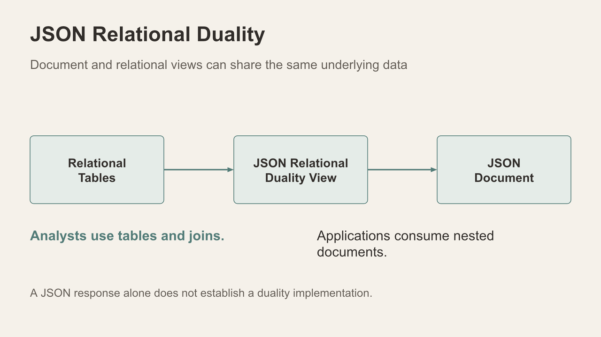
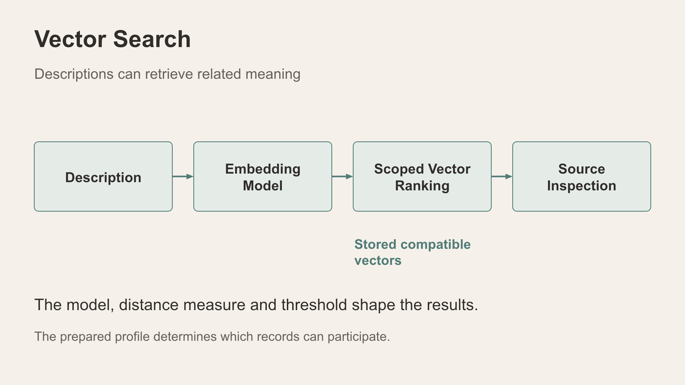

# Scene 1: Data Foundation

## Introduction

Establish the active city and signed-in scope, then use the five presenter tiles to introduce the database capabilities. The tile examples are local teaching simulations, not edits to incident records.

Estimated Time: 25 minutes

### Objectives

- Read the active profile and demo-persona context before interpreting any count.
- Explore JSON duality, Vector Search, Property Graph, Spatial and Deep Data Security.
- Locate the nine saved city profiles and distinguish profile review from restore.

## Task 1: Read the foundation screen

1. Select **Data Foundation**. Confirm the app title, active city and **Statewide administrator**. Read the incident, category, persona and watched-pattern cards as current-session values rather than fixed numbers.
2. Talk through **Relational & JSON**, **Vector-ready narratives**, **Graph & spatial context** and **Deep Data Security**. Each panel introduces a capability; later scenes reveal the specific execution path.
3. Scroll to the saved dataset profile library beneath the foundation tiles. The nine city choices are Adelaide, Perth, Brisbane, Amsterdam, Brussels, Dublin, Boston, Chicago and Las Vegas. Review the saved profile information without changing the active data.
4. Keep the active dataset unchanged. If the instructor requires a different city, prepare it before the workshop under the approved backup/recovery procedure. **Restore** replaces shared operational data for every user; it is not a learner step. Wait for profile metadata before interpreting counts.

**Presenter note:** The verified Perth profile had 33,511 incidents across three workshop patrol areas. These are dated examples, not fixed pass counts. Use another city only after checking its exercise prerequisites. Resource Manager scope follows the account; the selector is disabled.

## Task 2: JSON Relational Duality Views

**Animated pause:** [One incident, two views](../powtoons/index.html?story=duality).

1. Select **JSON duality views**. In the invented `DEMO-101` example, compare related incident/report rows with one JSON document.
2. Choose **Two views, one record**, change the table status to **Under review** and observe the two displays change together. Reset the example.
3. Explain that a defined duality view maps selected rows to a document. JSON output alone does not establish that a duality view is deployed for every IncidentData endpoint.

    

## Task 3: Oracle Vector Search

**Animated pause:** [Similarity is a lead](../powtoons/index.html?story=vector).

1. Select **Oracle Vector Search**, then **See similarity**. Compare Dog with the nearby Greyhound and Poodle examples; choose Car and read the changed ranking.
2. Explain that embeddings represent content numerically and distance helps rank related content. A score is not a probability or a person identification.
3. Later narrative and photo vector exercises require compatible prepared vectors in the selected profile. Check coverage before promising live matches.

    

## Task 4: Property Graph and Spatial

1. Select **Property Graph**. Follow Alex to a bicycle at one hop and the shop at two hops. Name the nodes, edges and recorded link types; the layout itself creates no relationship.
2. Select **Spatial**. Compare **Within distance** at 1 km with **In patrol area** in its invented grid. One tests distance, the other area membership.
3. Relate these concepts to the later case views and approximate incident map without claiming every drawn graph or map invokes a native database graph/spatial operator.

## Task 5: Deep Data Security

**Animated pause:** [Scope before search](../powtoons/index.html?story=security).

1. Select **Deep Sec · ABAC** and **Explore access decisions**. Compare North and Statewide area scope while keeping the other attributes visible.
2. Explain why a broader area can allow an additional standard record while a restricted record remains unavailable.
3. Reset the example. The tile is a local simulation; application scoped views and separately installed native DDS identities/grants are distinct demonstrations.

## Continue

Open **Incident Activity Center** to read current authorised activity in the active city.

## Acknowledgements

Content: IncidentData LiveStack contributors. Deployment instructions: LiveLabs team, November 2026.
