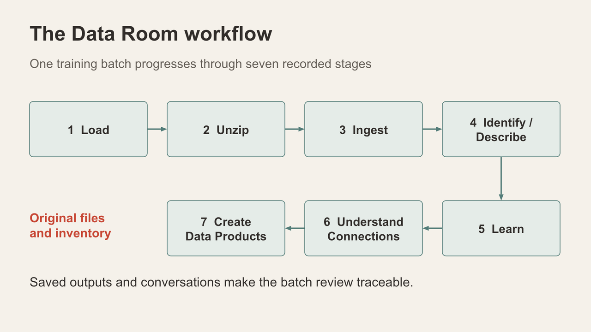

# Scene 12: Data Room

## Introduction

Use an instructor-provided synthetic package or a prepared saved batch to explain how files become traceable descriptions, connections and data products. The saved Alice Springs batch is separate from the active city's incident watch. Use a Workshop & Guides download only if the current deployment provides one.

Estimated Time: 14 minutes

### Objectives

- Explain all seven pipeline stages and the state of one selected batch.
- Use the five workspace tiles to navigate its outputs.
- Keep original files, AI drafts, connection suggestions and saved products distinct.

## Task 1: Choose a prepared batch

1. Select **Data Room**. In **Batch Load History**, select the prepared batch or inspect the already selected one. If `AliceSprings_Scenario_1A.zip` is available, use it as the example; record its actual batch ID, item count and stage status.
2. If demonstrating a new upload instead, select one individual synthetic ZIP from the expanded sample package. Confirm current file limits and synthetic-data checkbox before using **Load ZIP**. Do not upload the outer package or real evidence.
3. Read **Content Stats** and **Content Headlines** after loading. A zero shown while requests are still running is not a final inventory.

## Task 2: Explain the seven stages

**Animated pause:** [From ZIP to review pack](../powtoons/index.html?story=data-room).

1. **Load:** retain the original ZIP, assign a batch ID and record its checksum.
2. **Unzip:** extract accepted files from that individual ZIP.
3. **Ingest:** store validated items and their types in the content inventory.
4. **Identify/Describe:** create AI descriptions that remain drafts linked to original files.
5. **Learn what is there:** summarise saved descriptions into a source-linked Batch Brief.
6. **Understand Connections:** review source links, declared synthetic cast/scene context, whole-photo similarity and agent interpretations separately.
7. **Create Data products:** save a versioned review pack with a manifest and the available outputs.

The first three stages run through loading. Later stages have explicit controls and prerequisites and may invoke configured AI services. Explain incomplete or failed stages before moving on.

## Task 3: Use the workspace tiles

1. **Files:** inspect original inventory and descriptions; open one source reference.
2. **Explore:** inspect themes and candidate connections without treating a suggestion as a fact.
3. **Brief & Connections:** read the saved brief, its citations and connection types.
4. **Assistants:** inspect the batch conversation or guided assistance if available, checking responses against saved content.
5. **Outputs:** open a completed, versioned data product when present; state when none exists.

## Continue

Finish by inspecting the AI activity and measurement trail in **AI Opps**.

## Acknowledgements

Content: IncidentData LiveStack contributors. Deployment instructions: LiveLabs team, November 2026.
