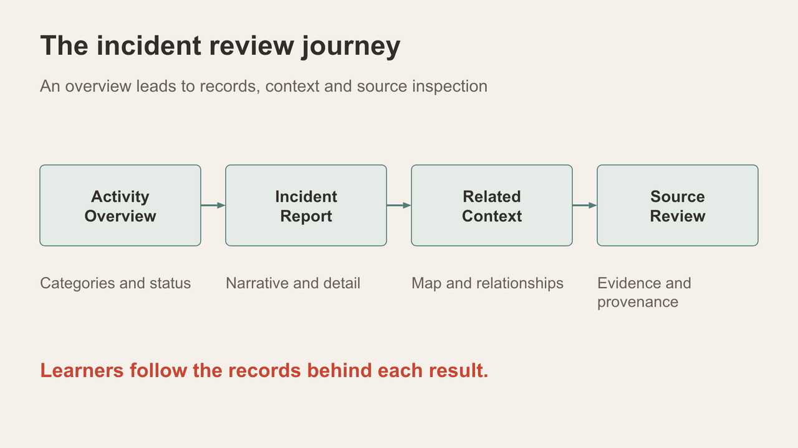

# Scene 2: Incident Activity Center

## Introduction

Begin with descriptive activity in the active city before following one lead. Counts depend on the profile, signed-in scope, record dates and filters.

Estimated Time: 6 minutes

### Objectives

- Read the current authorised incident and open-record totals.
- Separate watched patterns, community signals and area coverage.

## Task 1: Read the cards

1. Select **Incident Activity Center** with **Statewide administrator** selected. Record **Authorised incidents**, **Open records**, **Watched crime patterns**, **Community signals** and **Area coverage**.
2. Read the areas actually returned by your city profile. If a short relative-time chart is empty, inspect its date window against the stored record dates before drawing a conclusion.
3. Resource Manager scope is fixed by the account, so do not try to change the disabled selector. Optional: compare an instructor-assigned regional account in a separate browser profile or private session, then return to the original operator session. A second tab may reuse the operator login. Skip this comparison if no participant account was assigned. Only a local demo with an enabled selector uses in-page persona switching.

## Task 2: Explain the measures

1. Distinguish a stored incident from a watched pattern and a contextual community signal.
2. Explain why a smaller regional total shows different application results but does not by itself prove native database DDS enforcement.

## Continue

Use **Incident Pattern Signals** to move from the overall view to the payment-document watch.

## Acknowledgements

Content: IncidentData LiveStack contributors. Deployment instructions: LiveLabs team, November 2026.
