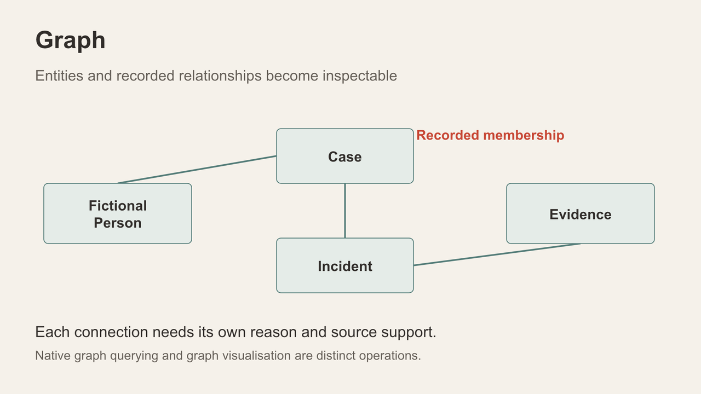

# Scene 3: Incident Pattern Signals

## Introduction

Follow a named payment-document watch while keeping authorised incident records separate from external context and similarity suggestions.

Estimated Time: 12 minutes

### Objectives

- Read the selected watch's scenario-ready panel without treating it as a finding.
- Explain the graph's nodes, links and display filters.
- Open a source incident from a selected graph node.

## Task 1: Select the watch

1. Select **Incident Pattern Signals**. Under **Watched Crime Patterns**, choose the active city's payment-document watch. The verified Perth label was **Art-market payment document trail**; an instructor-prepared Adelaide profile may use **Payment-Document Anomaly Chain**. Wait for the source trail to finish loading.
2. Read the selected watch's source-context panel. Record the actual linked-incident count, contextual-post count and case reference shown in this session.
3. Explain that the watch identifies records to inspect. Simulated public posts are unverified context, not an incident report or corroboration.

## Task 2: Explore result relationships

**Animated pause:** [A graph is a trail to inspect](../powtoons/index.html?story=signals).

1. Select **Explore result relationships** and wait for authorised relationships to load.
2. Read the legend: W for watch, I for incident and P for contextual post. Explain recorded membership, reviewed comparison and semantic similarity as different link types.
3. Compare the scenario's explicit watch links with the graph's total visible nodes; bounded related context may add more incidents.
4. In **Show records**, clear **Public posts**. Observe the new node and connection totals. This is a display filter; it does not delete source material.
5. Select a visible incident node. Read its detail card and choose its source-detail route if offered. Record that incident reference for Scene 8, then close the graph.

## Task 3: Handle an unavailable watch

1. If this watch, its source trail or compatible vectors are unavailable in the active profile, choose a populated watch and record its label.
2. Explain the missing prerequisite. Do not restore a dataset or invent a case ID or result count.

## Continue

Inspect fictional person context and the limits of narrative and photo comparison.

## Acknowledgements

Content: IncidentData LiveStack contributors. Deployment instructions: LiveLabs team, November 2026.
