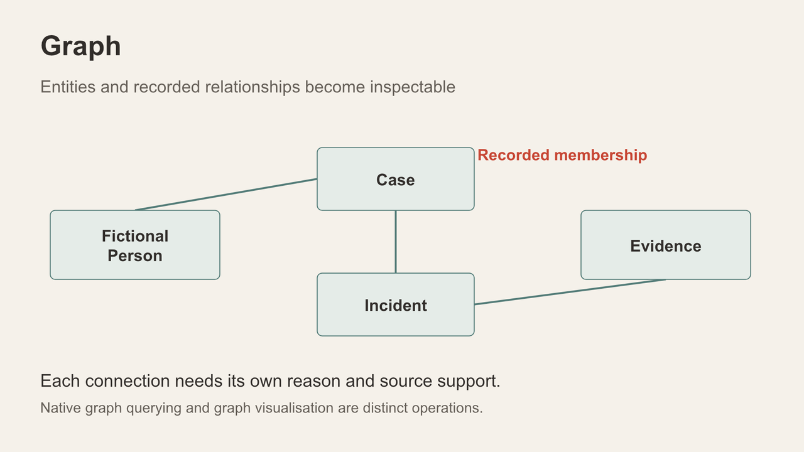

# Scene 6: Case Relationships

## Introduction

Use a payment-document case that exists in the active city and signed-in scope. Compare the graph presentations while keeping the same case and underlying sources in view.

Estimated Time: 10 minutes

### Objectives

- Inspect the case's incident, fictional-person and evidence-reference context.
- Compare all four graph-view choices, especially **Oracle Graph Explorer**.

## Task 1: Select a case and source

1. Select **Case Relationships** and choose the case referenced by the payment-document watch. Record its actual reference before presenting the graph.
2. Read the case summary and node/link counts. Open a connected incident or detail card and identify the original record behind one link.

## Task 2: Compare graph views

1. Switch through **Investigation network**, **Pathway Style**, **Force-directed network** and **Oracle Graph Explorer**, holding the same case constant. Read the current labels if a later build changes them.
2. In each view, point out how layout, clustering or exploration controls change the way relationships are inspected. Explain which links are recorded and which are optional similarity comparisons.
3. In **Oracle Graph Explorer**, double-click a node or use **Accessible node list and details** to inspect its source context. If sign-in or loading fails, use **Open graph sign-in page**, return and select **Retry Oracle view**. If it still fails, record the error and use **Investigation network**; do not disable authentication or iframe protections.

**Interpretation:** A graph drawing can render scoped relational links, while other features may query a native database graph. The visual style alone does not prove the database execution mechanism or a common offender.

## Continue

Add approximate geographic context in **Incident Map**.

## Acknowledgements

Content: IncidentData LiveStack contributors. Deployment instructions: LiveLabs team, November 2026.
