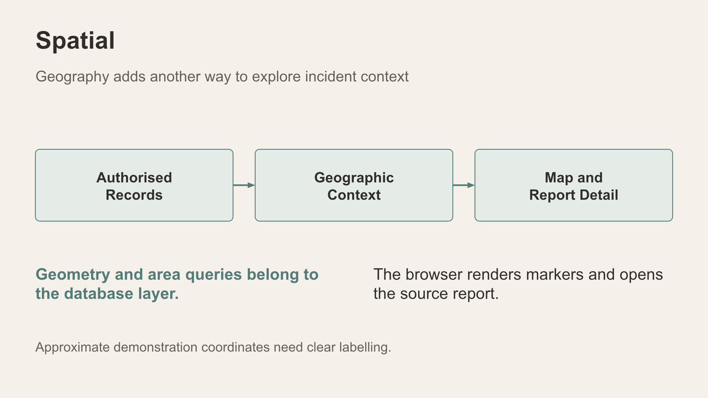

# Scene 7: Incident Map

## Introduction

The map adds approximate location context to authorised records. Its drawn markers can be fewer than all matching incidents.

Estimated Time: 5 minutes

### Objectives

- Use category, area, status and time controls.
- Explain map precision and marker limits.

## Task 1: Inspect the map

1. Select **Incident Map**. Record the current matching-record count and the number of drawn markers.
2. Change one filter at a time—category, patrol area, status or time—and explain the observed change.
3. If a marker opens a detail, compare its approximate position with the source report's location wording.

**Interpretation:** Display limits and clustering can reduce drawn markers. Nearby positions do not establish a common event or causal relationship.

## Continue

Use **Incident Explorer** to inspect original report detail with several search methods.

## Acknowledgements

Content: IncidentData LiveStack contributors. Deployment instructions: LiveLabs team, November 2026.
