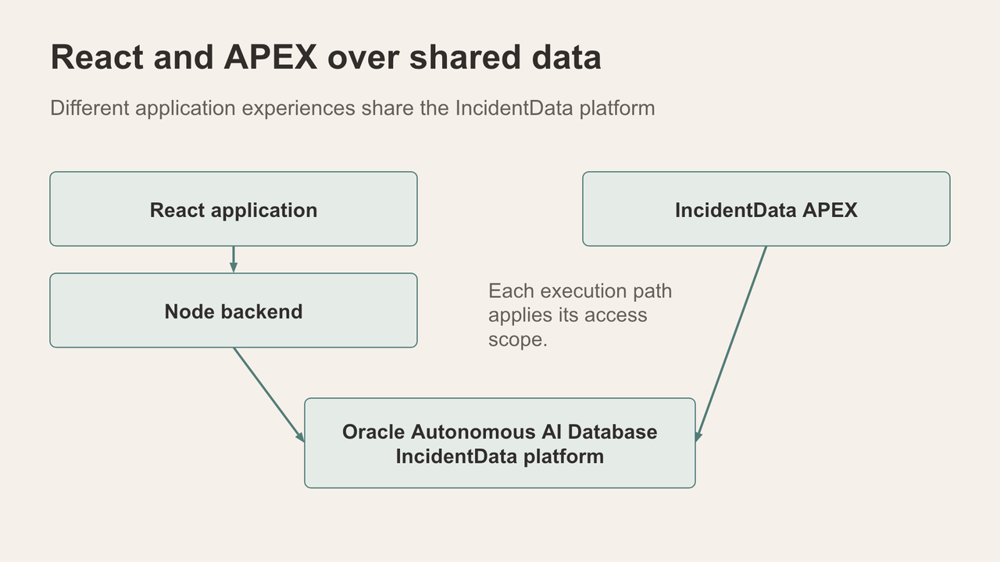

# Workshop & Guides — prepare the sample package

## Introduction

Collect the supplied synthetic training material before opening the scene sequence. The package includes test archives and photos that can support later Data Room and person-comparison exercises.

Estimated Time: 8 minutes

### Objectives

- Find the Part 2 Data Room guide and obtain its sample package.
- Separate the outer download from the individual ZIP files intended for testing.
- Keep the photos and their provenance available for the vector discussion.

## Task 1: Open Part 2

1. In the app's left navigation, select **Workshop & Guides**.
2. Choose **Part 2 — Data Room**. Read its preparation notes and locate its sample-download instruction. The Data Room ZIP Loader also exposes **Download sample ZIP** in builds where the guide points there.
3. Download the sample package to a clearly named local folder. Keep the original download intact.

## Task 2: Unzip and inspect

1. Expand the downloaded outer package with your laptop's archive utility.
2. List the contained test ZIP files and photos before choosing an exercise. Keep the individual ZIPs separate; do not feed the outer bundle to the Data Room loader as though it were one supported batch.
3. Note which photos are supplied synthetic scene material. They may be used later to discuss whole-photo vector similarity and person/narrative comparison where the feature and prepared data are available. A photo similarity result is not an identity finding.
4. Do not upload, delete or rerun a batch yet. Scene 12 explains the pipeline and its prerequisites.

## Continue

Move to **Data Foundation** and confirm the selected city and data scope.

## Acknowledgements

Content: IncidentData LiveStack contributors. Deployment instructions: LiveLabs team, November 2026.
